# 🌐 Infinity Lens — Landing Page

🌐 **English** · [Español](README_es.md)

A product website for an iPhone app, in **six languages**, with no tracking and no server. It explains the app in seconds and publishes the legal pages the App Store requires (privacy policy, terms, support).

🔗 Live site: [lens.infinitydev.agency](https://lens.infinitydev.agency)
📱 The app it promotes: see the [Infinity Lens](https://github.com/TheGeistGamer/infinity-lens) case study.

  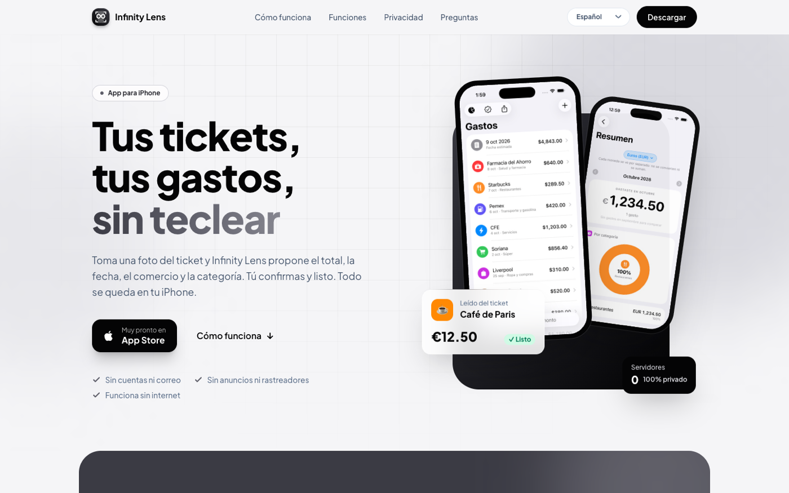
  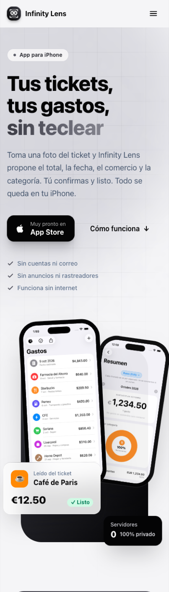

---

## 🎯 About the project

My app needed a website before it existed in the store: App Store requires a **public privacy policy** and a support link, and I also wanted a front page that explains the app quickly. Three constraints:

1. **Consistent with the app's promise:** no trackers, no tracking cookies.
2. **Truly multilingual**, because the app already shipped in six languages.
3. **Fast and cheap to maintain:** no server, no database.

## 📈 Measured results

Lighthouse on the published site (desktop, one run, 2026-10-13):

| Performance | Accessibility | Best practices | SEO | First contentful paint |
|:-:|:-:|:-:|:-:|:-:|
| **100** | **96** | **96** | **100** | **0.6 s** |

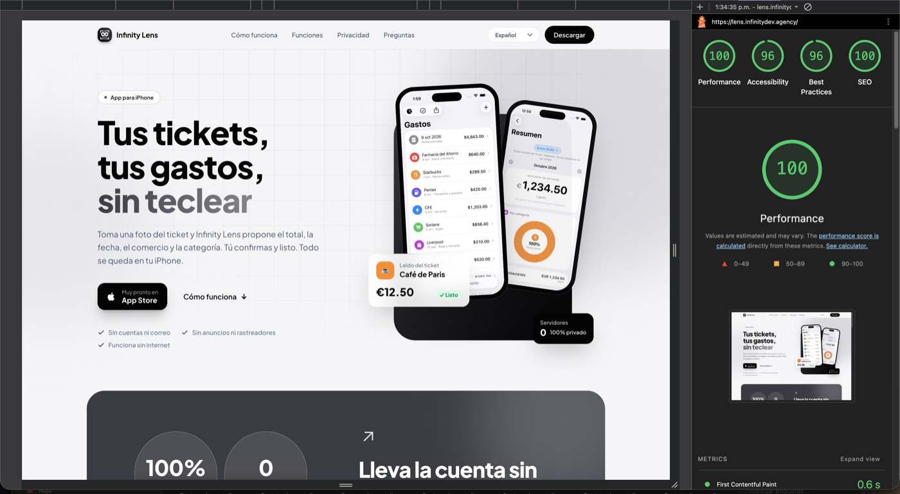

## 🛠️ Tech stack

| Technology | Role |
|---|---|
| [Astro 5](https://astro.build) | Static site generation, HTML by default |
| [React 19](https://react.dev) | Only for the 3 interactive components (header, steps, FAQ) |
| [Tailwind CSS 4](https://tailwindcss.com) | Design tokens and styling |
| Plus Jakarta Sans | Typography (800 weight, tight spacing for headings) |
| Cloudflare Workers (static assets) | Hosting, deployed with `wrangler` |

## 🧠 Key technical decisions

### Astro: HTML by default, JavaScript only where needed
It's a content page, not an application. Astro ships static HTML and sends JavaScript only to the three components that need it. Static output with no trailing slash and one `.html` file per page, so Cloudflare serves them as-is. I ruled out a full app framework: there's no state or data to justify one. About 1,400 lines in total between components and copy.

### A black-and-graphite identity
The logo tells the app without text: a camera viewfinder framing an infinity symbol, over a torn-edge receipt strip.

- **Neutral palette, no accent colour** (black `#040405`, graphite `#3B3B44`, silver, mist) — a deliberate choice to stand apart from the blue/green finance apps.
- **Tailwind 4 tokens** (`bg-brand-600`, `text-ink`, `bg-mist`): no hand-written colours in components.
- **Rules written down:** a single accent (white or silver), white text on graphite, never mid-grey (it loses contrast).

  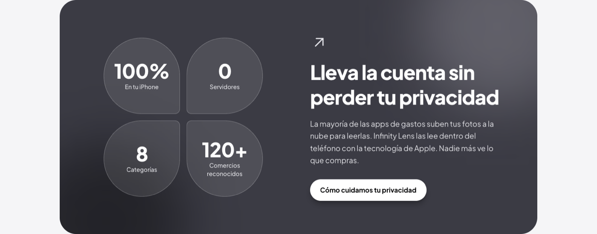
  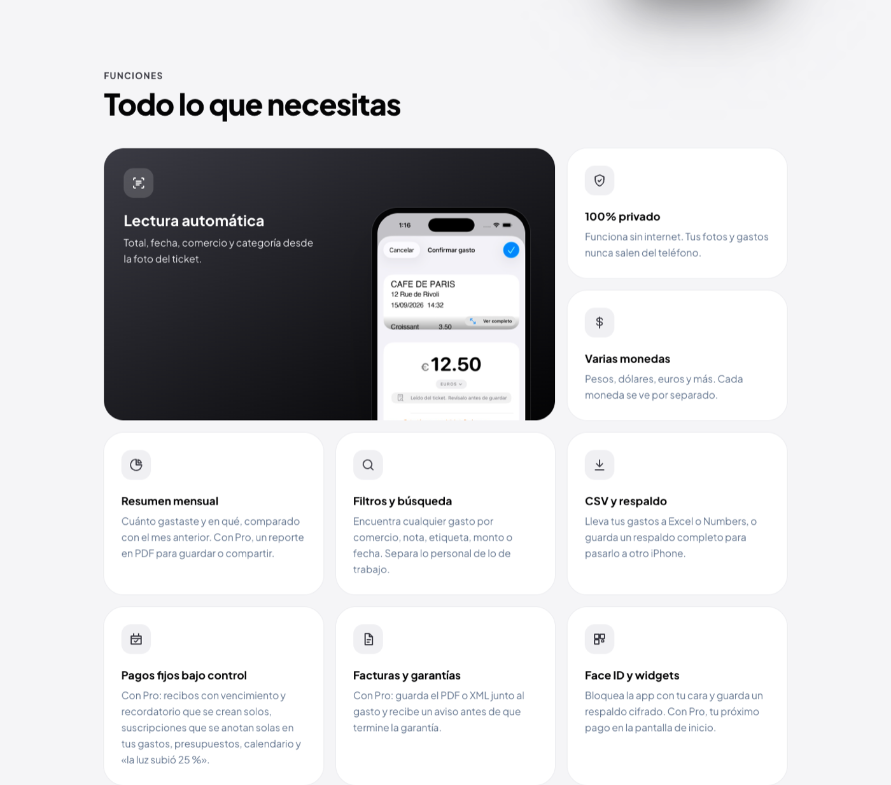

### Six languages without breaking SEO
Each language is a real page, not a translate button.

- **All copy in one file** (`src/i18n/ui.ts`), one block per language; pages just receive `lang`. Adding a language is four documented steps.
- **Per-language routes:** Spanish with no prefix, plus `/en`, `/pt`, `/fr`, `/de`, `/it`. In Portuguese even route names change (`/pt/privacidade`).
- **Metadata derived from the language list:** `canonical`, `hreflang` with `x-default`, `og:locale` and alternates, and a sitemap linking all versions.
- **JSON-LD** (mobile application) per language, and a share image generated from an HTML template with a headless browser.

  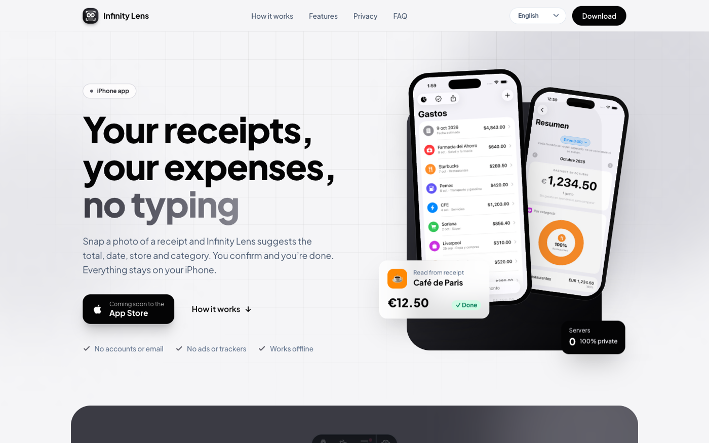
  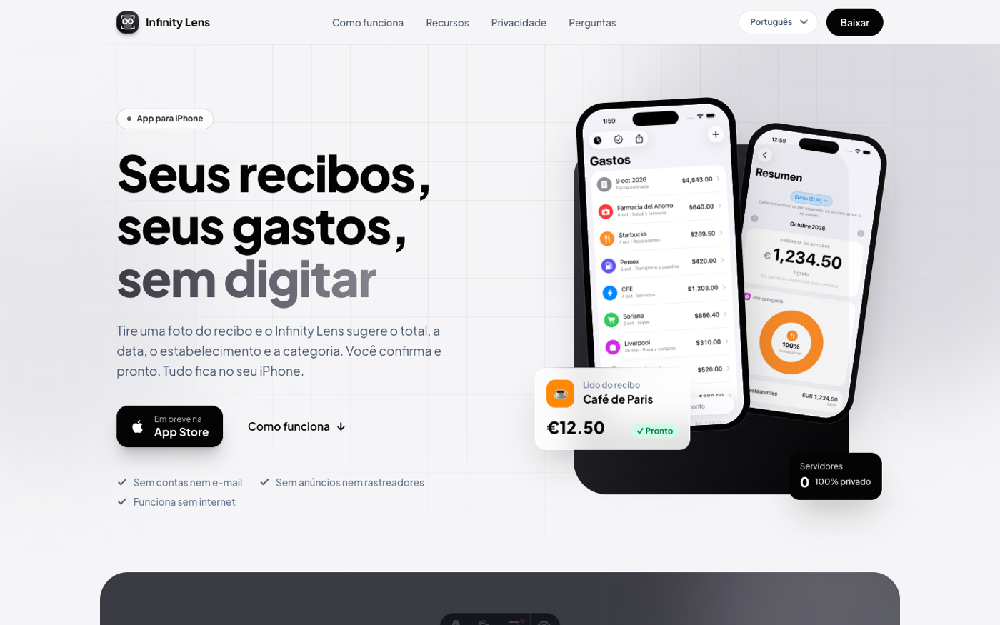
  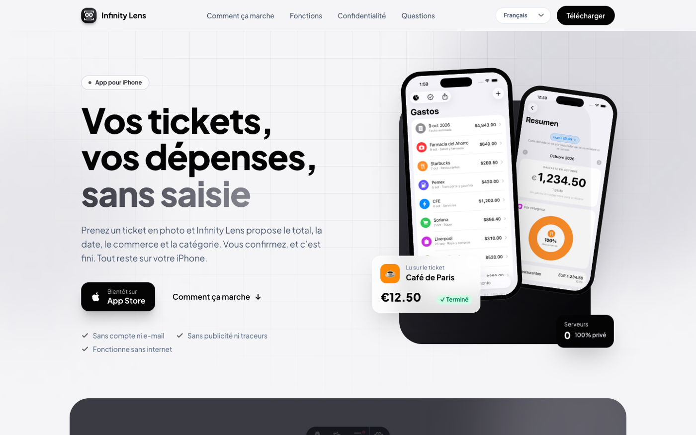

### Legal text that stays up to date
The app promises "no internet, no data collected", so the public policy must say exactly the same. Project rule: whenever an app feature changes what happens with data, the in-app privacy screen, the web policy, Apple's privacy manifest and the App Store Connect labels are updated **together**. Policy, terms and support are written in full in every language.

  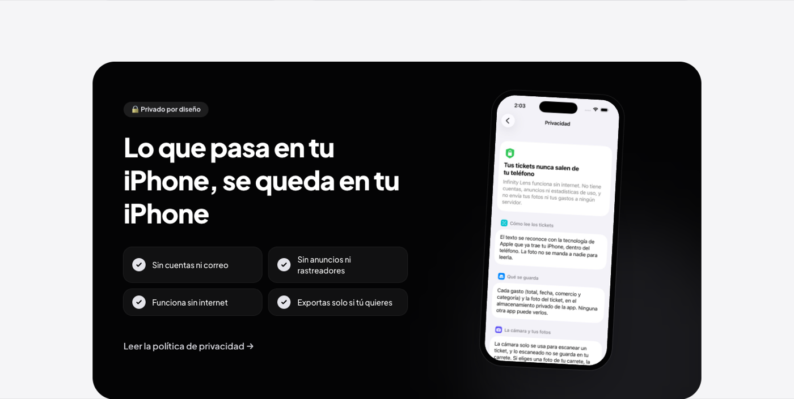
  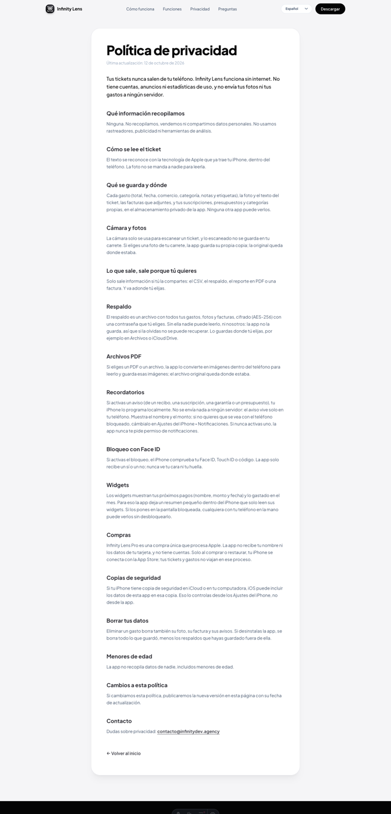

### Responsive: from phone to desktop
The nine-feature grid goes from an irregular layout to a single column; hamburger menu and language selector on small screens; FAQ as a React accordion. For mobile screenshots I used a headless browser inside a 390 px iframe.

  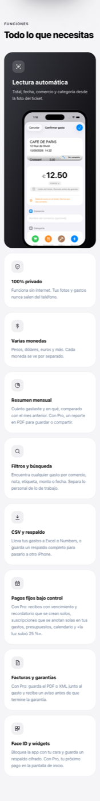
  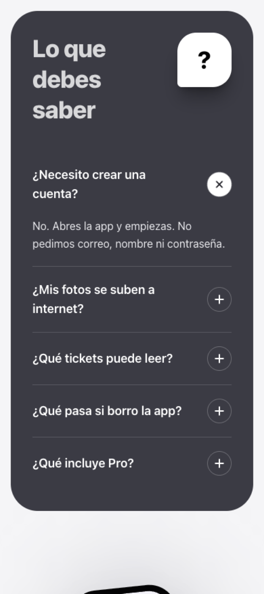

### Deploy on Cloudflare
`npm run deploy` builds with Astro and uploads `dist/` using `wrangler.jsonc`. No server to maintain, no database to protect. I first published on a `workers.dev` address and moved to the custom domain once I had it, updating `site`, `robots.txt` and the sitemap together.

## 🌱 What I learned / what I'd improve

- A product website is part of the product: the legal policy matters as much as the hero.
- Documenting the palette and rules keeps things consistent for anyone who maintains it.
- Languages are architecture, not a patch at the end.

Known pending items (honest list):
- Add the real App Store link and price (it currently says "coming soon").
- Small grey text on legal pages has ~2.6:1 contrast (a darker grey reaches 4.8:1).
- Native-speaker review of the PT/FR/DE/IT translations.

## 📄 Note

This repository contains **documentation only**; the source code is private.

## 📬 Contact

**Infinity dev by Frank** · [GitHub](https://github.com/TheGeistGamer) · [Infinity](https://infinitydev.agency)
